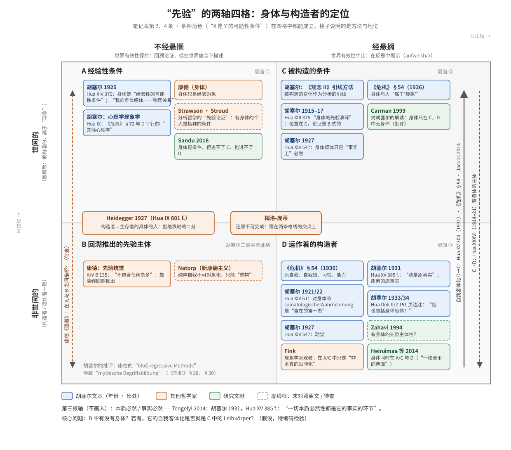

# 关于Leibkoerper的笔记本

## 使用说明

每条笔记开头有一行标签，按三个维度分类（标签可在 Obsidian 中直接筛选）：

- **等级**（这条笔记对研究计划有多重要）
  - `#等级/A`：核心，直接检验工作假说，或决定某一部分的论证走向
  - `#等级/B`：支撑，为论证提供证据、对照或反例
  - `#等级/C`：背景，术语、语境、研究文献线索
- **文本层**（引文在胡塞尔文本中的地位，引用时必须区分）
  - `#文本/定稿`：正文或附录（Beilage）的有效文本
  - `#文本/改稿`：胡塞尔本人的修改、增补（见校勘附录）
  - `#文本/删稿`：胡塞尔删去的文字
  - `#文本/编者`：编者的标题、导论、注释
- **状态**（处理到哪一步）
  - `#状态/摘录`：只摘了原文，尚未核对
  - `#状态/已核对`：页码与原文已对照
  - `#状态/已分析`：已有自己的解读，可直接用于写作
- **类型**（可选，仅用于非胡塞尔文本）
  - `#类型/研究文献`：二手文献笔记。此时"文本层"标签不适用，改为说明其中引用的胡塞尔文本是否已对照原文

每条笔记的结构：出处 → 原文 → 译文 → 要点 → 与研究计划的关联 → 待查问题。

---

## 1. Hua XXXIV Nr. 27：对笛卡尔二元论与心物平行论的批判

`#等级/A` `#文本/定稿` `#状态/已核对` · 关联：Part IV（Leiblichkeit 的先验地位）

### 出处

Hua XXXIV, Text Nr. 27: „Kritik des cartesianischen Dualismus. Die Undenkbarkeit einer Welt überhaupt, die ihren Seinssinn nicht aus meinem Bewusstseinsleben hat" (Februar 1933), S. 401, Z. 22 – S. 402, Z. 31（PDF 451–452）。

### 原文（核心句：S. 402, Z. 6–15）

> Ebenso wäre jeder „Parallelismus" ein Widersinn, der das Zusammen von Bewusstseinsleben und **körperlicher Leiblichkeit** als eine bloß faktische Koordination behandeln wollte, als eine bloße Hypothese, die uns die Welterfahrung empfiehlt, bereit, bei entsprechender neuer Erfahrung durch andere Hypothesen ersetzt zu werden. Abermals ist die Wechselwirkung leer und aus gleichen Gründen widersinnig, sofern auch sie die Notwendigkeit der Verbindung von Leib und Seele wie eine allgemein bloße Empirie behandelt und als wie die einer Kausalität, die die Sterne eines Doppelsternpaares verbindet.

### 译文

> 同样，任何"平行论"都是悖谬的，只要它想把意识生活与**躯体性的身体性**的共在，当作一种单纯事实上的并列来处理，当作世界经验向我们推荐的一种单纯假说，随时准备在有了相应的新经验时被其他假说取代。交互作用论同样是空洞的，并且出于同样的理由是悖谬的，因为它也把身体与心灵之结合的必然性当作一种普遍的单纯经验之事来处理，就好像这种结合是把双星中的两颗星联结起来的那种因果性一样。

### 上下文（S. 401, Z. 22 – S. 402, Z. 5，概要）

- 笛卡尔在悬搁后指出，自我不是心理物理的人，因为自己的身体也从感性经验获得存在确定性，所以身体也被悬搁所涵盖。
- 但他随即把剩下的自我理解为"纯粹心灵的自我"，即"成问题的世界中不成问题的一块"，由此被诱入二元论。
- 胡塞尔：把我的心灵看作上帝毁灭其余世界后仍能留存的具体实在，是悖谬的。笛卡尔二元论"不是一种可能的形而上学假说，而是一种必然确定的悖谬（apodiktischer Widersinn）"。
- 紧接核心句之后（S. 402, Z. 16–31）：若这些观点成立，我就必须能设想意识生活存在而世界不存在，或设想真实存在的是"一种我无法认识的存在"。"所有这类想法都是彻头彻尾的悖谬。"

### 要点（解读草稿，待修改）

1. **世间层面：拒绝"分离"，保留"区分"。** 平行论与交互作用论的共同错误，是把身心之间本质的、构成性的共属关系，当成可被新经验推翻的经验假说。身心是一个统一体中两个抽象的环节。参照 Hua IV, S. 340 注："这是一种'抽象的'区分（eine ‚abstraktive' Scheidung）"。
2. **先验层面：身心统一体本身也被悬搁。** 胡塞尔纠正笛卡尔，不是说"剩下的是身心统一体"，而是说任何世界内的东西都不是剩余物。必然确定的是构造世界的先验意识生活；身心统一体是统觉的成就、被构造的意义。
3. **在这一段中，körperliche Leiblichkeit 与 Leib 同指。** 核心句前半用 körperliche Leiblichkeit，后半用"Leib und Seele"，指的都是心理物理之人的躯体方面。
4. **胡塞尔并没有简单取消二分，而是把二分移了位置。** 原来是世界中的两块（物与心），现在是对同一意识生活的两种态度（世间的与先验的）。见同卷 Nr. 26 标题„Psychologie und Phänomenologie in Parallelismus"。

### 同卷相关出处

完整的 17 处出处表见 `胡塞尔_统计/Hua34_Leibkoerper_出处表.md`。与本条直接相关的：

| 页,行 | 文本层 | 内容 | 关联 |
|---|---|---|---|
| S. 392, Z. 22 | 定稿 | Nr. 26：„mein **Leibkörper** und alles Seelische, als zu ihm zugehörig apperzipiert in psychophysischer Apperzeption" | 身心统一是统觉的成就（要点 2） |
| S. 392, Z. 32–33 | 定稿 | Nr. 26：„Die **körperliche Leiblichkeit**, die Weltlichkeit zunächst als Natur geht immer voran" | 自然态度下躯体性总是先行 |
| S. 432, Z. 35 | 定稿 | Nr. 30：„Dabeisein als **Körper-Leib**, der aber Leib ist als eine Körperlichkeit, in deren Bewegungen ich mich bewege" | 身体作为功能运作者，不只是被构造者 |
| S. 535 | 删稿 | Nr. 4 删文：„mein menschliches Dasein … zum bloßen Phänomen … und ebenso mein Seelenleben als … Vorkommnis in der Welt und an meinem **Leibkörper**" | 悬搁把身体躯体上的心灵生活也变成现象（要点 2），但这是删稿 |

### 与研究计划的关联

- **Part IV 第 4 章：** 如果连身心统一体都是被构造的，"先验的身体"在什么意义上可以成立？本条给出的是胡塞尔 1933 年的正式立场：身体属于被构造的一侧。
- **对照文本：** Hua XV, S. 287（Nr. 17，1931 年 9 月）。胡塞尔在那里先把"自我化了的身体躯体"放在被构造一侧，随即自问"但是能这样划分吗？"。两处应当并读：一处是坚定的立场，一处是自我质疑。
- **与 Part II 的连接：** Nr. 30（S. 432）把 Körper-Leib 描述为"我在其运动中运动我自己"的躯体性，说明在同一时期，身体仍然承担功能运作的角色。这与"被构造的一侧"之间的张力，正是你研究计划的核心问题之一。

### 待查问题

- [x] Hua IV, S. 340 注的完整上下文与断代：据新版 Hua IV/V 校勘附录（S. 847），此注原是手稿上的**铅笔页边注**，1952 年版作为脚注排印。引用时应注明"页边注"。见 `胡塞尔_统计/Leibkoerper_改稿与编辑记录.md` E2
- [ ] 《笛卡尔式的沉思》§57 关于"平行论"的表述（尚未核对）；《危机》§72 已部分核对，见第 2 条
- [ ] 《危机》§53–54"人类主体性的悖论"（既是世界的主体，又是世界中的客体）：身体躯体是否正是这个悖论的所在？
- [ ] Nr. 26 全文：心理学与先验现象学"平行"的具体含义，以及身体躯体在其中的位置

---

## 2. "先验"的两轴四格：方法轴与地位轴（原题：两种"先验"）

`#等级/A` `#文本/定稿` `#状态/已核对` · 关联：Part IV（Leiblichkeit 的先验地位），以及计划中的康德比较。引文与页码已核对，区分本身是解读草稿。

### 区分（修订版：两轴四格）

**修订原因。** 初版把"先验"分为条件论意义上的先验₁ 与构造论意义上的先验₂，并用一张表对照。但那张表把两个相互独立的标准捆在了一起：**方法**（是否经过悬搁）与**地位**（作为条件的 X 是否属于世界）。康德正好落在两者之间：他的先验统觉"不包含任何杂多"（KrV B 135），不是经验对象，地位上是非世间的；但他的条件是在不悬搁世界有效性的情况下，靠回溯论证得出的，方法上不经悬搁。所以初版说"康德基本属于先验₁"是错的。

**方法轴（横）：怎样通达条件。**
- **不经悬搁**：世界有效性保持不变。条件或者通过**回溯论证**获得（康德的先验演绎，分析哲学中的"先验论证"），或者在世界信念之下**描述**出来（心理学现象学）。
- **经悬搁**：世界有效性被中止。条件在对构造生活的反思中被**展示**出来（在这一框架内也可以被演绎，见证据 4）。

这正是胡塞尔自己批评康德时使用的标准：康德"bloß regressive Methode"（《危机》§28，S. 106 f.）导致了"mythische Begriffsbildung"（§30，S. 116 f.）。在 §53 中他把自己的结果称为"einer aufweisbaren, und nicht argumentativ konstruierten oder in einem mythischen Denken erdachten"（可展示的，而非论证地构造出来的，或在神话式思维中想出来的）（S. 184）。

**地位轴（纵）：作为条件的 X 被规定为什么。**
- **世间的**：X 是世界中的东西（物理物、心理物理的人）。在悬搁之后，这意味着 X 是**被构造的**，属于"作为被构造之极的世界"（《危机》§54："这一切都属于'现象'"）。
- **非世间的**：X 不是世界中的对象，而属于构造者、运作者一侧。

**四格：**

| | **不经悬搁** | **经悬搁** |
|---|---|---|
| **世间的** | **A：经验性条件。** 世界中的 X 作为某类经验的条件，例如胡塞尔 1925 年说的"经验性的可能性条件" | **C：被构造的条件。** 作为被构造者的 X 在构造分析中充当条件或引线，例如《观念 II》的引线方法 |
| **非世间的** | **B：回溯推出的先验主体。** 非经验的条件，靠论证推出，不能直观展示，例如康德的先验统觉 | **D：运作着的构造者。** 在反思中展示的构造生活本身，例如《危机》§54 的原自我（"在其全部成就和所获之中"） |

（图中各家的位置见下文"各立场的定位"表；图由 `scripts/notebook_grid_svg.py` 生成，修改位置时改脚本后重新生成。）

**条件角色与格子是两回事。** "X 是 Y 的可能性条件"这一条件角色，在四格中都可以成立。初版的"先验₁"其实就是这一条件角色，"先验₂"只对应 D 格。所以，"身体是可能性条件"只说明身体在某一格里，不说明在哪一格。以下仍用"先验₁"简称条件角色，用"先验₂"简称 D 格。

**§53 悖论在格子中的位置：** 同一个主体性既是"Subjektivität in der Welt als Objekt"，同时又是"für die Welt Bewußtseinssubjekt"（S. 184）。前者在 A 格（悬搁后为 C 格），后者在 D 格。§54 的解决，是用自我客体化来说明 D 与 C 的关系，而不是把两者当作部分与整体。

**用语上的提醒：** 不要说"世间的先验"，在胡塞尔的读者听来这像自相矛盾。文中可以直接用格子的两个维度来说：例如"不经悬搁的、世间的条件"（A），或者用胡塞尔自己的说法"经验性的可能性条件"。

### 与三个层面的对应，以及一处修正

- **层面 ① = A 格**（世间-心理学）：在世界信念之下，陈述身体是知觉的可能性条件。
- **层面 ② = C 格。** 《观念 II》的引线方法中止了世界信念，只把被构造的意义当作分析的引线，属于还原之后的分析。真正"预设世界信念"的是心理学态度下的分析，例如 Hua IX 和下面那段 1925 年的引文（A 格）。
- **层面 ③ = D 格，它的边界正是争议所在。** 《危机》§54 所说的严格先验者，不只是纯粹自我（自我极），而是"在其全部成就和所获之中"的原自我，包括习性和能力。而"能力"的范例是身体性的（见《观念 II》§59）。所以纯粹自我只是 D 格的最小情形。
- **B 格在胡塞尔的三个层面中没有位置。** 它是康德的格子，也是胡塞尔批评的对象（"回溯方法"）。但证据 4 表明，胡塞尔在 C 格中借用过 B 格的论证方式。

### 胡塞尔的证据

**1. 身体作为"经验性的可能性条件"**：Hua XIV, Beilage XLVI（1925 年夏季讲座），S. 375，约 Z. 35–41。

> "Und in dieser physischen Umwelt als meiner Welt wirklicher und möglicher Wahrnehmung, als welche ich damit selbst erfasse und erfassen kann, **ist mein Leib gegeben als Nullpunkt der Orientierungsgegebenheiten und als empirische Bedingung der Möglichkeit für alle Erscheinungen**, als das physische Ding, worin ich walten kann, aber so, dass dieses Walten (Betätigung meiner Organe) für alle dingliche Erscheinung Abläufe der Form der freien Wahrnehmungsabläufe zur Folge hat."

> 而在这个作为我的现实的和可能的知觉世界的物理周围世界中，**我的身体被给予为定向被给予性的零点，以及一切显现的经验性的可能性条件**，即我能在其中支配的那个物理物；而这种支配（我的器官的活动），对一切物的显现都带来自由知觉进程这种形式的进程。

同页稍前（约 Z. 19–21）：

> "…um sie als Data für das Tasterscheinende gewinnen zu können, **muss mein Leibkörper in gewissen physischen Beziehungen zum ‚betasteten' äusseren Körper stehen**."

> ……为了能把它们获得为被触摸显现者的材料，**我的身体躯体必须与"被触摸的"外部躯体处于某种物理关系之中**。

要点：这正是先验₁，即在世界被设定为有效的前提下，身体是知觉的可能性条件。但胡塞尔明确称之为**经验性的**条件。用来表述这一条件的，是 **Leibkörper** 与"物理关系"。

**2. "先验心理学"与平行论**：《危机》§72，S. 268 f.（页码待对照原书确认）。

> "Es gibt nur eine transzendentale Psychologie, die identisch ist mit der transzendentalen Philosophie."

> 只有一种先验心理学，它与先验哲学是同一的。

> "…alles Weltliche hat seine transzendentalen Korrelate, es sind mit jeder neuen Enthüllung für den Menschenforscher, den Psychologen, neue Bestimmungen des Menschen in der Welt."

> ……一切世间之物都有其先验的相关项，随着每一次新的揭示，对于人的研究者、心理学家来说，它们都是关于世界中的人的新规定。

要点：在心理学（世间）态度中，可以得到与先验结果内容相同的东西，只是它们被统觉为"世界中的人的规定"。先验₁ 由此在胡塞尔那里有一个正式的位置：内容上与先验结果平行，意义上属于世间。胡塞尔紧接着说，这一说法"在何种意义上需要修正"有待考虑，所以这句话不能孤立引用。

**3. 先验₂ 的标准与范围**：《危机》§54。

> "Konkret ist jedes Ich nicht bloß Ichpol sondern Ich in allen seinen Leistungen und Leistungserwerben, mitgerechnet die als seiend und soseiend geltende Welt. Aber in der Epoché … zeigt sich eo ipso nichts Menschliches, nicht Seele und Seelenleben, nicht reale psychophysische Menschen – all das gehört ins ‚Phänomen', in die Welt als konstituierten Pol."（S. 187）

> 具体地说，每个自我不仅是自我极，而是在其全部成就和所获之中的自我，包括作为存在着和如此存在着而有效的世界。但在悬搁中……显现出来的根本没有任何属人的东西，没有心灵和心灵生活，没有实在的心理物理的人——这一切都属于"现象"，属于作为被构造之极的世界。

原自我"立于一切自然此在之上"（S. 188）。

要点：先验₂ 的标准是"不是世界的一部分"。但"属于现象（被构造之极）"不等于"属于世间层面"：被构造的现象本身就是先验研究的课题。要区分三组概念：世间 / 先验（态度之别）；被构造的 / 运作着的（先验态度内部之别）；事实的 / 本质必然的。

**4. "身体的先验演绎"**：Hua XIII, Text Nr. 14（1915–1917），S. 375, Z. 7–24（经 Sandu 2018 发现，见第 3 条）。

> "**Transzendentale Deduktion des Leibes:** Was kann ein Subjekt appräsentieren? Appräsentation setzt voraus, dass, wenn auch das Appräsentierte nicht selbst schon erfahren war, und zwar im Erfahrungszusammenhang mit dem Appräsentierenden, doch ein Analoges in analogem Zusammenhang erfahren war. Soll fortdauernd im stetigen originären Jetzt Appräsentation erfolgen können (das fremde Ich dauernd für mich da sein können), so muss das Appräsentierende dauernd für mich existieren. **Also ist es nur möglich, dass** in meinem Erfahrungsbereich ein Gegenstand als dauernde Existenz konstituiert ist und dass mit diesem Gegenstand meine gesamte Subjektivität als erfahrungsmässig verknüpft gegeben ist. (Also auch objektive Zeit ist transzendental deduziert.) Dieser Gegenstand als objektiv dauernd und die gesamte originär wahrgenommene Subjektivität an sich knüpfend kann nur ein **transzendent konstituierter Gegenstand** sein: Wir nennen ihn ‚mein Leib' (L). Soll nun in Analogie damit fremdes Subjekt appräsentierbar sein, so muss es in meinem Erfahrungsbereich andere, dem L ähnliche Gegenstände L' etc. geben …"

> **身体的先验演绎：** 一个主体能共现什么？共现的前提是：即便被共现者本身从未被经验过，即从未在与共现者的经验关联中被经验过，也必定有一个类似者在类似的关联中被经验过。如果要在持续的原本的现在中能够持续地发生共现（陌生自我能够持续地为我在此），那么共现者就必须持续地为我存在。**所以只可能是：**在我的经验域中，有一个对象被构造为持续的存在，并且我的全部主体性被给予为与这个对象经验性地联结在一起。（因此客观时间也被先验地演绎了。）这个对象，作为客观上持续的、把全部原本地被知觉的主体性系于自身的对象，只能是一个**超越地被构造的对象**：我们称之为"我的身体"（L）。如果陌生主体要能以与此类比的方式被共现，那么在我的经验域中就必须有其他与 L 相似的对象 L' 等等……

同一文本 S. 376 注 1："Das alles ist offenbar transzendental deduzierbar."（这一切显然可以先验地演绎。）

要点：
- **论证方式是 B 格式的**：一个回溯的条件论证明，从"他人应能持续被共现"倒推出"必须有一个持续的、系住全部主体性的对象"。
- **所处的位置是 C 格**：论证在悬搁之后、在构造论的语言里进行，结论是一个"被构造的"对象。"transzendent"在这里是"内在"（immanent）的对立词，指不实项地属于意识流，不是含糊的说法。
- **被演绎的是作为交互主体性条件的身体**，不是作为知觉条件的身体。这与证据 1（1925 年，身体是知觉的"经验性的"可能性条件）构成对照：同一个"条件"角色，1915–17 年被称为"先验演绎"，1925 年被称为"经验性的"条件。
- 由此可见：①条件角色可以落在任何一格，从"身体是条件"推不出它在哪一格，更推不出"身体不可构造"，这正是 Sandu 论证的缺口（见第 3 条）；②"以被给予性取代演绎"不能无条件地概括胡塞尔（Heinämaa 等 2014 导论 p. 7 正是这样概括的），至少在身体与交互主体性问题上，胡塞尔用过演绎。

### 各立场的定位（四格版）

| 立场 | 身体在哪一格 | 先验主体 / 构造者在哪一格 | 依据与说明 | 核对 |
|---|---|---|---|---|
| 康德（《纯粹理性批判》） | A：身体只是经验对象 | B：先验统觉"不包含任何杂多"（B 135），不是经验对象 | 条件靠先验演绎回溯得出；胡塞尔批评其为"bloß regressive Methode"（《危机》S. 106 f.） | 胡塞尔引文已核对；KrV 待核 |
| 康德（《遗著》） | A，或试图在 A 与 B 之间搭桥？ | B | 主体通过身体的运动力"自我设定" | 待查 |
| 新康德主义（Natorp） | A | B：纯粹自我不可对象化，只能被"重构" | 胡塞尔 1913 年前拒绝纯粹自我，与 Natorp 有争论（导论 p. 7） | 待查 |
| 分析哲学的先验论证（Strawson、Stroud） | A：有身体的个人是同一性指称的条件（Strawson《Individuals》第 3 章） | 不设 B：Strawson 的"简朴"康德去掉了先验观念论 | 是 A 格的标准形态，可作术语参照 | 未核对 |
| 胡塞尔 1925（Hua XIV, S. 375） | A："经验性的可能性条件"；"我的身体躯体……物理关系" | — | 见证据 1 | 已核对 |
| 胡塞尔，心理学现象学（Hua IX；《危机》§72） | A | A 中有一个与 D 内容平行的"先验心理学" | 见证据 2 | 已核对 |
| 胡塞尔 1913 年前后（《观念 II》引线方法） | C | D 的最小情形：纯粹自我 | 层面 ② | 已核对 |
| 胡塞尔 1915–17（Hua XIII, S. 375） | C，但用 B 格式的演绎得出 | — | 见证据 4："Transzendentale Deduktion des Leibes" | 已核对 |
| 胡塞尔 1914/15–1921（Hua XXXVI Nr. 7、Nr. 9） | 从 C 向 D 推进：实在世界的相关者必须是有身体的主体 | D：无身体的主体是"绝对唯我论的"（S. 164） | 进入层面 ③ 的路径 (a) | 已核对 |
| 胡塞尔 1921/22（Hua XIV, S. 61） | 指向 D：对身体的"somatologische Wahrnehmung""对作为运作着的自我的我而言是自在的第一者" | D | 见第 3 条 | 已核对 |
| 胡塞尔 1927（Hua XIV, Beilage LXXIV，S. 547） | 动觉在 D；身体躯体在 C，而且只是"事实上"必然 | D | 第三根轴：事实必然性 | 已核对 |
| 胡塞尔 1931（Hua XV, S. 287、S. 300） | D→C："身体……将自身构造为躯体"；并质疑"但是能这样划分吗？" | D | 进入层面 ③ 的路径 (b)，发生现象学 | 已核对 |
| 胡塞尔 1932 年夏（Hua Dok II/2, S. 151，对 Fink 改写稿的页边注） | 质疑把身体排除出 D："Aber auch den Leibkörper! Wenn ich nicht die universale Sinnlichkeit ausschalte und so meine Welterfahrung überhaupt."（但也包括身体躯体！除非我排除了全部感性，从而排除我的世界经验本身。） | D | 所在文本为"Umarbeitung der I.–V. Meditation (Sommer 1932)"；注号挂在哪一句，OCR 未保留，待对照原书 | 已核对（日期已更正，原记 1933/34 有误） |
| 《危机》§54（1936） | C："这一切都属于'现象'" | D：原自我，只有自我极、习性与能力 | 进入层面 ③ 的路径 (c)；D 中是否有身体性的"能力"，悬而未决 | 已核对 |
| Fink《第六笛卡尔式沉思》 | — | 现象学旁观者在 D；它在 A/C 中的出现只是"非本真的世间化" | §10–11 | 已核对 |
| Heidegger 1927（Hua IX, S. 601 f.，致胡塞尔信的附件） | 拒绝纵轴的二分 | 构造者是"具体的人"，但人"作为存在者从不是'世间实在的事实'，因为人从不只是现成的，而是生存着的" | 纵轴被重新定义：世间的≠现成的；方法上不接受悬搁 | 已核对 |
| 梅洛-庞蒂 | 落在格线之上：还原不能完成（横轴无法干净地走到右列）；身体-主体既是条件又在世界中（纵轴无法干净地分开） | 同左 | "完全的还原不可能"；"还原的不完整性就是还原本身" | 二手转引 |
| Zahavi 1994（研究计划注 6） | D？先验主体性本质上是有身体的 | D | | 待查 |
| Carman 1999 | 他认为胡塞尔把身体放在 C | 他认为胡塞尔的 D 本质上没有身体 | 批评；他借梅洛-庞蒂主张身体占据条件角色，但不在 D | 已核对 |
| Sandu 2018 | 主张身体既进不了 C（构造失败），也进不了 D（逃脱悬搁） | — | 从条件角色直接推出格子位置，混同（见第 3 条） | 已核对 |
| Heinämaa / Hartimo / Miettinen 2014（导论） | 从"不可设想无身体的知觉"推出身体是"先验条件"；身体同时在 A/C 与 D（"同一枚硬币的两面"） | D：个别的、人称的先验自我 | 方向与 Sandu 相反，但也是从条件角色推出格子位置；只提 §53 悖论，未提 §54 的解决 | 已核对（导论 pp. 8–9） |
| Tengelyi 2014 | 不对应某一格：引入第三根轴，即事实必然性 | — | 据导论 p. 12 的概述 | 待读原章 |
| Jacobs 2014 | D→C："先验主体性及其作为人的自我构造" | D | 据导论 pp. 12–13 的概述 | 待读原章 |

### 与研究计划的关联（2026-11-04 修订）

- **本研究的论点（研究者 2026-11-04 明确）：** 不是证明胡塞尔那里存在一个"先验的身体"，而是证明**胡塞尔对身体的使用始终在先验与经验之间摇摆、混淆，而这种摇摆会影响自康德以来对"先验"的界定**。本条初稿把"D 格中有没有身体"写成核心问题，又提出"移植"问题，都是对研究目标的误读，已删去。
- **四格的用途是诊断：** 摇摆，就是同一个身体功能（零点、动觉、感觉的定位、"条件"角色）在 A、C、D 之间移动，而胡塞尔既没有标明这种移动，也没有为它论证。证据汇总见第 6 条。
- **"可能性条件"正是摇摆的载体：** 条件角色在四格中都成立，所以胡塞尔可以在同一角色之下，一时把身体称为"经验性的"条件（1925，证据 1），一时把它当作"先验演绎"的对象（1915–17，证据 4）。
- **康德比较：** 康德的先验与经验问题在 A 与 B 之间。胡塞尔这里，问题复现于 A/C 与 D 之间。待论证的主论点（中等强度）：这种摇摆不是胡塞尔个人的疏失，而是结构性的。凡承认条件具有身体性的先验哲学，都守不住康德式的界线（先验 = 非经验的先天条件）。康德《遗著》中的"自我刺激"（研究计划注 7）可能显示同样的摇摆，待查。
- **与 Leibkörper 词汇线索的可能对应（假设，待编码检验）：** Leibkörper 及相关复合表达，是否集中出现在功能发生移动、而胡塞尔未加标明的地方？例如 1925 年"我的身体躯体……物理关系"（A）、1927 年"Faktisch sind die Kinästhesen in meinem Leibkörper lokalisiert"、1931 年"verichlichter Leibkörper"（第 6 条）。《危机》中的 körperlicher Leib 则用于先验维度在世界中的定位（§59，S. 214）。
- **第三根轴（不画进表格）：** 必然性的模态，即本质必然还是事实必然（Tengelyi 2014）。它与两轴交叉。例如 1927 年胡塞尔认为身体躯体只是"事实上"如此（第 6 条证据 2）。

### 待查问题

- [x] Heinämaa / Hartimo / Miettinen（编）《Phenomenology and the Transcendental》（2014）的导论：已读。导论没有给出"先验"含义的分类，工作定义把条件与构造揉在一起；它对身体的论述见上表。促成了本条改为两轴四格
- [ ] Zahavi 1994 所说的"可能性条件"：身体被放在 C 格还是 D 格
- [ ] 《危机》§72 前后文：胡塞尔所说"需要修正"的具体内容；S. 268 f. 页码对照原书
- [ ] Hua XIV, Beilage XLVI 全文：1925 年讲座中"经验性的可能性条件"是否有与之对照的"先验的"说法
- [ ] 康德"先验"概念的界定（KrV B 25、B 80 f.、B 132–135）：核对康德放在 B 格的依据（先验统觉"不包含任何杂多"）
- [ ] 康德《遗著》中的身体：是否尝试在 A 与 B 之间搭桥（研究计划的康德比较）
- [ ] Tengelyi、Jacobs、Taipale、Heinämaa 在该书中的各章：Tengelyi 的"事实必然性"（第三根轴）；Jacobs 的"先验主体性自我构造为人"（D→C）
- [ ] Strawson《Individuals》第 3 章、Stroud 1968、Smith & Sullivan（编）2011：A 格中的"先验论证"传统，用作术语参照
- [ ] Natorp《Allgemeine Psychologie》（1912）的"重构方法"：确认新康德主义在 B 格

---

## 3. Sandu 2018：身体"逃脱悬搁"？胡塞尔身体构造论的一份批评

`#等级/B` `#类型/研究文献` `#状态/已核对` · 关联：第 2 条（两种"先验"）；Part IV；"笛卡尔式二元论"指控与 Leibkörper 词汇线索。文中所引胡塞尔原文的主要几处已对照语料，结果见下文"引文核对"。

### 出处

Paul Gabriel Sandu, „Konstitution oder Deduktion des Eigenleibes? Paradoxien der Leiblichkeit in der transzendentalen Phänomenologie Husserls", *Meta: Research in Hermeneutics, Phenomenology, and Practical Philosophy* X/2 (2018), S. 317–332. 作者的博士论文（Freiburg）题目是胡塞尔的先验交互主体性。

### 主张（概要）

- 胡塞尔的身体构造论有两种尝试：**构造**（Hua XIII 早期手稿：身体是"在意识中自身构造者"；Hua XIV 75 f.：身体"自身构造"）与**演绎**（Hua XIII 375："身体的先验演绎"）。Sandu 认为两者都失败了。
- 失败的原因：身体是一切显现的可能性条件，本身"不显眼"（unscheinbar，借 Figal 2015），从不作为"显现的统一体"出现，因此不能在本己领域中被构造，"逃脱现象学悬搁"（S. 327–328）。
- 胡塞尔把身体称为"器官""载体"，沿用了笛卡尔式的 res extensa / res cogitans 二分，并且从未反思这一比喻（S. 323）。Hua XIII 240（1914/15）是少数的例外，那里胡塞尔"意识到了自己残余的笛卡尔主义"。
- 结论：借梅洛-庞蒂（"还原的不完整性就是还原本身"）、Figal、Derrida，把现象学改造为对"始终已身体化、已世界化的（交互）主体性"的事实性分析，即诠释学（S. 328 f.）。

### 在本研究框架中的位置

- 与 Carman、梅洛-庞蒂同属一个阵营：否定《危机》§54 第 4 步，即身体最终不能被收回到先验自我中。
- **核心缺口：混同了先验₁ 与先验₂。** 他的推论是"身体是可能性条件 → 身体不可构造、不可悬搁"。而胡塞尔 Hua XIII 375 的演绎本身就表明，条件论形式的论证可以在构造论框架之内进行（见第 2 条证据 4）。
- **也混同了"被构造的"与"运作着的"。** "不显眼"的是运作着的身体，被演绎为"超越地被构造的对象"的是被构造的身体。胡塞尔所说的"双重构造"（Hua XIV 76）正是针对这一双重性，Sandu 却把它读成了反身性的自我构造（见下表）。
- **文本面很窄。** 他只用了 Hua XIII–XV 的若干处（以及 Hua I、IV、VIII），没有处理 Hua XXXVI（1914–21 对先验观念论的证明）、Hua XV 1931 年"身体……将自身构造为躯体"的发生线，也没有处理《危机》§54。所以他"胡塞尔直到 30 年代末都没有成功"的判断依据不足。

### 对本研究有用的文本线索

| 出处 | 内容 | 用途 |
|---|---|---|
| Hua XIII, Text Nr. 14（1915–17），S. 375 | "Transzendentale Deduktion des Leibes" | 第 2 条证据 4 |
| Hua XIII, Text Nr. 9（1914–15），S. 270 | 编者所拟标题："Das Problem der Erfassung der Ähnlichkeit von fremdem und eigenem **Leibkörper**"；正文："der Leibkörper wird durch Mittel indirekt vorstellig … Mein Leib ist ein Körper, dem originär erlebte Empfindungsfelder zugeordnet sind" | Leibkörper 词汇线索：1914–15 年在交互主体性语境中的用法；Leib 被定义为"一个躯体"（Leib … ist ein Körper） |
| Hua XIII, Text Nr. 2（1909 年前），S. 25–27 | "Wahrgenommen wird der Leib als ‚mein' Körper …"；"Gehen wir nun zurück zur Selbstwahrnehmung, so ist der Leibkörper wahrgenommen …" | 早期 Leibkörper 用法；"Selbstwahrnehmung"的语境 |
| Hua XIII, Text Nr. 7（1914–15），S. 240 | "Mein Leib ist das Hier, aber er ist nie im objektiven Raum als Objekt erfahren …" | 运作着的身体；与"零点"对照 |
| Hua XIV, Text Nr. 3（1921/22），S. 61, Z. 18–33 | 对身体的"somatologische Wahrnehmung""是我作为运作着的自我的自在第一者"；作为身体的被给予"细看之下并不奠基于它作为物理物的被给予"。胡塞尔加注限定："Doch nur in dem allgemeinen Sinn: Die Praxis steht überall und immer voran der ‚Theorie'." | **奠基方向问题的中间点**：介于 1913 年（Hua XIII S. 70）与 1931 年（Hua XV S. 300）之间。经核对，此段不在删除范围内：被删的是 60,22–31 和 61,34–63,11 |
| Hua XIV, Beilage VI（"1921 oder etwas später"），S. 76 | "dass er selbst an und für sich selbst **doppelt** konstituiert ist" | Leib/Körper 双重构造的直接证据。**注意：** Beilage VI 是胡塞尔对 S. 61 ff. 的"Korrektur"（编者标题：Das Problem der Konstitution des Leibes als eines physischen Dinges in der solipsistischen Erfahrung），开头即说："Der Anschlag, den ich da mache, ist unvollkommen und wohl inkorrekt. Vor aller Funktion als Aussenleib ist der Leib für sich selbst konstituiert in besonderer Weise. 1) Voran geht ein Fungieren des Ich in der Kinästhese …"（S. 75）。S. 61, Z. 34 – S. 63, Z. 11 被删时，胡塞尔注明参看这一修正。这是奠基方向问题和 D 格中身体的重要文本，待细读 |
| Hua XV, Text Nr. 17（1931），S. 283 | "ich bin nicht Ergänzungsstück dieses Körpers, als ob dieser wie andere Körper sein könnte, sondern bin kontinuierlich darin Waltender" | 反对把自我理解为躯体的"补充部分"，即反对部分-整体式的身心结合（Sandu 注 5 标为 S. 285 ff.，引文实在 S. 283） |
| Hua XV, Beilage XL（约 1932），S. 567 | 标题："Mein Leib – seine Originalität. Alle Dinge in originaler Gegebenheit oder Habe sind vermittels meines Leibes in seiner Originalität gegeben" | 身体作为原本性的中介 |
| Hua XV, S. 584（1932–35） | "Nicht einmal Strömen und Leben darf hier im ernstlichen Sinn verstanden werden." | "最终先验者"的边界 |
| Hua VIII, S. 73 | "…durch eine sozusagen erkenntniskritische Vernichtung meines Leibes wie des Weltalls überhaupt nie Zu-vernichtende" | 《第一哲学》中身体随世界一起被加括号；胡塞尔紧接着说"我当然不可以这样表述……"，引用时需带上下文 |

### 引文核对：发现的问题

| Sandu 的说法 | 原文 | 问题 |
|---|---|---|
| 身体"an und für sich selbst konstituiert"，据此读作反身性的自我构造（标为 Hua XIV 75–76） | S. 76："dass er selbst an und für sich selbst **doppelt** konstituiert ist" | 漏掉"doppelt"。胡塞尔说的是身体既作为物、又作为身体被构造，不是反身性的自我构造 |
| "transzendente Konstitution"是一个含糊的概念，暗示身体相对于意识的独立（Hua XIII 375） | "kann nur ein transzendent konstituierter Gegenstand sein" | "transzendent"是"内在"的标准对立词，不含糊。他还删去了"Also ist es nur möglich, dass"，把条件句读成了直陈句 |
| 身体与他人一样是"kein Phänomen im Sinne der Phänomenologie"（标为 Hua XIII 374） | S. 372–375 未找到；相近表述在 S. 433（Text Nr. 15，1918）："[Die Phänomene …] sind also nicht Phänomene im Sinne der Phänomenologie, sind keine reinen Phänomene" | 页码疑误（也可能是 OCR 漏检）。原文说的是在他人身体上被共现的陌生体验，不是身体本身；推广到身体是 Sandu 自己的类比 |

### 与研究计划的关联

- **与本研究论点的关系（2026-11-04 修订）：** Sandu 与本研究都认为胡塞尔在身体问题上不稳定，但**诊断不同**。Sandu 认为根源是沿用了笛卡尔式的身心二分；本研究认为根源是先验与经验之间的摇摆。胡塞尔确有超出 Leib/Körper 二分的词汇，并在 Hua XIV 76（"双重构造"）、Hua XV 283（"不是补充部分"）处明确拒绝了部分-整体式的结合模型。这些文本反驳的是 Sandu 的"笛卡尔主义"诊断，不反驳摇摆论点。
- **可作为第 2 条区分的实例：** 说明为什么必须区分先验₁ 与先验₂。不区分，就会从"身体是条件"直接推出"还原失败"。

### 待查问题

- [ ] 翻纸本核对 Hua XIII S. 374：确认是否确有"kein Phänomen im Sinne der Phänomenologie"（排除 OCR 漏检）
- [ ] Figal 2015《Unscheinbarkeit. Der Raum der Phänomenologie》，S. 4、155–160：Sandu 依赖的"不显眼"概念
- [ ] Hua XIII, Text Nr. 14 全文（1915–17）："身体的先验演绎"在这篇文本的整体论证中处于什么位置；同卷 S. 376 注 1 的上下文
- [ ] Hua XIII, Text Nr. 9（1914–15）中 Leibkörper 的全部出处，纳入词汇编码

---

## 4. 交织与合法性：如果先验与经验交织，先验如何还能合法地存在？

`#等级/A` `#文本/定稿` `#状态/已分析` · 关联：第 2 条（两轴四格）；Part IV；康德比较；研究计划中"先验与经验的交织"命题。胡塞尔引文已核对；本条的两难论证与对等论证是自己的重构，不是现有文献中的定论，需进一步检验。

### 问题

如果可以直接宣称先验与经验是交织的（例如 Heinämaa / Hartimo / Miettinen 2014 导论所说的"同一枚硬币的两面"），先验还如何能合法地存在？

### 简答

交织不能只是"宣称"出来的。只是宣称，先验确实会失去合法性；如果交织能在反思中被**展示**为先验生活自身的结构，先验就仍然合法，只是意义要重新界定。合法性的关键在**方法轴**，不在**地位轴**。

### 一、"交织"的四种含义

| 含义 | 例子 | 威胁先验吗 |
|---|---|---|
| ① 承担者同一：同一个我既是先验的又是经验的 | Heinämaa 等 2014；《危机》§53 | 不威胁，只要说明两者的关系（§54 的自我客体化） |
| ② 内容平行：每个先验结果都有世间的对应项 | 《危机》§72，"先验心理学" | 不威胁，平行预设了区分 |
| ③ 依赖：先验功能依赖于世间结构（身体、语言、代际） | Heinämaa 等 2014 导论 p. 11 | **可能威胁**，看依赖的方向（见第三节） |
| ④ 方法上做不完：还原不能完全完成 | 梅洛-庞蒂 | 看如何理解（见第二节） |

### 二、两难论证：说"交织"的人站在哪里？

"先验与经验是交织的"本身是一个论断，它只能从两种位置说出：

- **从 A 格说出**（世界信念之下）：它是经验性论断（如"认知依赖身体"），谈不到 D 格。它不能废除先验，只能对先验避而不谈，这就是自然主义。
- **从 D 格说出**（悬搁之后）：交织成为一个先验的发现，说的是构造生活如何自我客体化、如何嵌入世界。这已预设先验视角是合法的。

梅洛-庞蒂属于后者："还原给我们的最大教益，是完全的还原是不可能的"（《知觉现象学》序言；**凭记忆转述，待对照原文**）。还原的不完整是执行还原得出的结果，不是从外部对它的否定。

跳出这一两难的只有 Heidegger：构造者就是实际生存的此在（Hua IX, S. 601 f.）。但他在《存在与时间》里仍称此在分析为"先验的认识"（据 Heinämaa 等 2014 导论 p. 10 转引）。连最激烈的批评者也保留了先验的名称与功能。

**限度：** 这个两难只保住了先验的**立足点**，没有保证先验是"纯粹的"。它说明交织可以合法地成为先验研究的课题，没有说明交织是什么样的。

### 三、合法性靠什么

- **如果靠地位轴**（先验者在存在上与世界分离），承认交织就等于取消先验。这是康德的处境：合法性来自先天性和非经验性（B 格），身体一旦进入先验，就破坏了这一点；《遗著》的困难可能由此而来（待查）。
- **胡塞尔的合法性靠另外两样东西：**
  1. **可展示性（方法轴）**："einer aufweisbaren, und nicht argumentativ konstruierten oder in einem mythischen Denken erdachten"（可展示的，而非论证地构造出来的，或在神话式思维中想出来的）（《危机》§53，S. 184）。
  2. **有效性的方向**：世界的存在意义从构造生活中获得有效性，反过来不成立。

由此得到判断交织的标准：

- **合法的交织**：D 依赖 C，但这种依赖本身是被构造的，是 D 自我客体化为 C 的结果，并且可以在反思中展示。
- **非法的交织**：D 的有效性由 C 中作为世间事实的东西奠基（例如身体的物理性质决定什么算作有效）。有效性方向倒转，结果是自然主义。

问题因此不在"能不能承认交织"，而在"交织是被宣称的还是被展示的"。Heinämaa 等人从"不可设想无身体的知觉"直接推出"身体是先验条件"，是不经悬搁的本质变更论证，属于宣称；Sandu 方向相反，犯的是同一个错（第 3 条）。

### 四、胡塞尔自己在重新界定先验：事实性进入先验内部

Hua XV, Text Nr. 22，S. 385 f.（编者标题："Teleologie. Die Implikation des Eidos transzendentale Intersubjektivität im Eidos transzendentales Ich"，"aufgrund von Noten vom 5. November 1931"；页眉属"Cartesianische Meditationen" 1931–1932 一组）：

> "Eben im Verwiesenwerden auf die **Urfakta der Hyle** (im weitesten Sinn); **ohne die wäre keine Welt möglich und keine transzendentale Allsubjektivität**. … Wir kommen auf letzte ‚Tatsachen' – Urtatsachen, auf letzte Notwendigkeiten, die Urnotwendigkeiten. Aber ich denke sie, ich frage zurück und komme auf sie schliesslich von der Welt her, die ich schon ‚habe'. Ich denke, ich übe Reduktion, ich, der ich bin und für mich in dieser Horizonthaftigkeit bin. **Ich bin das Urfaktum** in diesem Gang, ich erkenne, dass zu meinem faktischen Vermögen der Wesensvariation etc. in meinem faktischen Rückfragen sich die und die mir eigenen Urbestände ergeben, als Urstrukturen meiner Faktizität. Und dass ich in mir einen Kern von ‚Urzufälligem' trage in Wesensformen, in Formen vermöglichen Funktionierens, in denen dann die weltlichen Wesensnotwendigkeiten fundiert sind. … Seine Notwendigkeit ist nicht Wesensnotwendigkeit, die ein Zufälliges offen liesse. **Alle Wesensnotwendigkeiten sind Momente seines Faktums** …"

> 正是在被指向**质素的原事实**（最广义的）这一点上：**没有它们，就没有世界可能，也没有先验的大全主体性可能**。……我们达到最后的"事实"，即原事实，达到最后的必然性，即原必然性。但我思考它们，我回问，并最终从我已经"拥有"的世界出发达到它们。我思考，我进行还原，我，就是这个在这种视域性中为我存在的我。**在这一进程中，我就是原事实**；我认识到，在我事实性的回问中，相应于我事实性的本质变更能力等等，得出这样那样我所特有的原持存，它们是我的事实性的原结构。并且我认识到，我在自身中承载着一个"原偶然"的核心，它在本质形式之中，在能力性运作的形式之中，世间的本质必然性就奠基在这些形式中。……它的必然性不是那种为偶然留有余地的本质必然性。**一切本质必然性都是它的事实的环节**……

另见 Hua XV 编者导论 S. XXXIX 所引胡塞尔的系统著作提纲："Die transzendentale Notwendigkeit des ‚Faktums' des ego"（自我之"事实"的先验必然性）。

要点：

- "先验"在晚期胡塞尔那里不再等于先天地纯粹：先验主体性有一个事实性的核心（第三根轴，参见 Tengelyi 2014 的"事实必然性"）。
- 这个核心包括**质素（Hyle）**，即感性。身体正是从这里进入的。对照 1932 年夏的页边注："但也包括身体躯体！除非我排除了全部感性……"（Hua Dok II/2, S. 151）。
- 先验对感性事实的依赖，这一交织的关键部分，胡塞尔是在先验**内部**承认的。
- 对"是胡塞尔造成了错误，还是先验本身需要重新界定"这一问题：文本表明，胡塞尔自己已经沿第三根轴重新界定了先验。尚未完成的是地位轴上身体的位置。

### 五、与研究计划的关联（2026-11-04 修订）

本条初稿把"合法的交织"当作为先验身体辩护的途径，与本研究的论点不符（见第 2 条的修订说明）。本条现在的用途是：

1. **提供衡量胡塞尔的尺子：** 胡塞尔自己的合法性标准是"可直观展示"和"有效性的方向"。论文要检验的是：在身体问题上，他是否达到了自己的标准。第 6 条显示，他多处依靠演绎、类比，或未加说明的词汇转换来下结论。
2. **原先的"对等论证"改作预期的反驳：** 为胡塞尔辩护的人会说：运作着的自我同样匿名，匿名性不取消先验自我的合法性，所以也不取消先验身体的合法性。本研究的回应（自己的重构）：自我可以退回一个没有内容的"极"，匿名性几乎没有代价；运作着的身体却有内容（动觉场、定位的感觉、零点、质素），对这些内容的任何描述都必须对象化，从而落入 C 格或 A 格（见第 5 条第五节）。对等因此不成立，这正是身体使摇摆难以避免的原因。
3. **Hua XV 的"原事实"：** 可作为胡塞尔承认先验内部有事实性的证据。它是对先验概念的重新界定，还是摇摆的又一种形式，需要在论文中论证。
4. **与康德比较：** 康德的交织问题在 A 与 B 之间，没有反思通道；在胡塞尔这里问题复现于 A/C 与 D 之间。胡塞尔有自我客体化这一模型，也有事实性进入先验内部的重新界定，但这些能否消除摇摆，正是本研究要检验的。

### 待查问题

- [ ] 梅洛-庞蒂《知觉现象学》序言中"完全的还原不可能"一句的原文与页码
- [ ] Heidegger《存在与时间》§7 中"先验的认识"（veritas transcendentalis）的原文
- [x] Hua XV, S. 385 f. 所在文本：Text Nr. 22，"Teleologie"，据 1931 年 11 月 5 日的笔记
- [ ] 同组文本（Hua XV Nr. 20–23 前后）中"Urfaktum"的其他出处
- [ ] 胡塞尔论运作着的自我的"匿名性"与"事后"反思的文本（如《危机》§54b、Hua XXXIV），用于对等论证
- [ ] Tengelyi 2014 原章：事实必然性与胡塞尔"原事实"的关系

---

## 5. 旁观者与运作者：Fink 的二分、旁观者对世间意义的依赖、运作者的通达问题

`#等级/A` `#文本/定稿` `#文本/改稿` `#状态/已核对` · 关联：第 2、4、6 条；Part IV；"先验定义"论点。胡塞尔与 Fink 的引文均已对照语料。第四节"五种通达方式"的归纳和第五节的"机制"是**自己的重构**。

### 出处

- Fink《第六笛卡尔式沉思》：Hua Dok II/1, S. 12、13、22、82 f.（含胡塞尔页边注 240–242）、108 f.（§10）
- 胡塞尔：《笛卡尔式沉思》§15（Hua I, S. 72 f.）；《危机》S. 110 f.、§59（S. 214）；Hua Mat VIII, Ms. C 2, S. 2；Hua X 附录 IX（语料为 Meiner 版，Hua 页码 S. 119）；Hua XIV, S. 61 与 Beilage VI（S. 75）

### 一、Fink 的二分：先验主体性内部的裂缝

> "Der Vollzug der phänomenologischen Reduktion lässt **im Felde der transzendentalen Subjektivität eine Kluft aufbrechen**, stiftet eine Scheidung des transzendentalen Seins in zwei heterogene Bezirke. Die transzendentale Elementarlehre hat es mit dem einen dieser Bezirke zu tun: mit dem transzendentalen Konstituieren (mit der Welt- und Seinsbildung). Das an der Weltkonstitution **‚unbeteiligte'**, sich von ihr durch die Epoche distanzierende Leben des **phänomenologisierenden Zuschauers** ist der Gegenstand der Methodenlehre."（Hua Dok II/1, S. 22）

> 现象学还原的执行**在先验主体性的领域中撕开了一道裂缝**，把先验存在分成两个异质的区域。先验要素论处理其中一个区域：先验的构造（世界与存在的形成）。那个**"不参与"**世界构造、通过悬搁与之保持距离的**进行现象学研究的旁观者**的生活，则是方法论的对象。

Fink 进一步问："‚Konstituiert' überhaupt noch der transzendentale, an der Weltkonstitution unbeteiligte Zuschauer?"（那个不参与世界构造的先验旁观者，还在"构造"吗？）（S. 13）

**一处修正：** 研究者最初把二者理解为"两种态度"。更准确地说，旁观者是一种态度（不参与的反思）；运作者不是态度，而是在**一切**态度中进行构造的生活，包括在自然态度中，也包括在旁观者的反思活动之中。

### 二、旁观者是自我的一部分

> "…daß sich eine **Ichspaltung** vollzieht, in dem sich über dem naiv interessierten Ich das phänomenologische als **uninteressierter Zuschauer** etabliert. Daß dies statt hat, ist dann selbst durch eine neue Reflexion zugänglich, die als transzendentale abermals den Vollzug eben dieser Haltung des uninteressierten Zuschauens fordert…"（《笛卡尔式沉思》§15，Hua I, S. 73）

> ……发生了一种**自我分裂**：在素朴的、有兴趣的自我之上，现象学的自我作为**无兴趣的旁观者**确立起来。这一点本身又只有通过一种新的反思才能通达，而这种反思作为先验的反思，又要求执行同样的无兴趣的旁观态度……

旁观者自己的反思活动又是运作着的，因而是匿名的。所以对运作者的课题化总是"mit einem Rest, der unthematisch, der sozusagen **in Anonymität bleibt**, nämlich als die für diese Thematik fungierenden Reflexionen"（带着一个未成为课题的、可以说停留在**匿名之中**的剩余，即为这一课题而运作着的那些反思）（《危机》，Hua VI, S. 110 f.）。

晚期手稿把这一点写成无穷的分裂与同一化：

> "Dabei bin ich, das ‚Subjekt' dieses neuen Gegenüber, ‚anonym'. … So reflektierend und immer wieder reflektierend finde ich immer wieder Gegenüber-Seiendes und Ich … Ich finde in diesem **beständigen Sich-Spalten des Ich und Sich-dann-wieder-Identifizieren** ein Ich, das ich als **Urpol, als ursprünglich fungierendes Ich** bezeichne…"（Hua Mat VIII, Ms. C 2, S. 2）

> 在这里，我，这个新的对面的"主体"，是"匿名的"。……这样反思又反思，我总是一再发现对面的存在者和自我……在自我这种**持续的自我分裂、随后又重新自我认同**之中，我发现一个自我，我称之为**原极，即原初运作着的自我**……

**要点：** 旁观者不是一个独立的第二主体，而是自我在分裂中形成的一个样态；而且裂缝不只出现一次，每一次反思都会重新产生它。

### 三、旁观者不能独立于世间意义

**Fink 的立场：** 先验主体性只能"仿佛它是一个存在者"那样被谈论，因为通达它的唯一道路是从自然态度出发。

> "Und trotzdem müssen wir die transzendentale Subjektivität ansetzen, **gleichsam als ob sie ein Seiendes wäre**. Wir haben gar keine andere Möglichkeit, sie zu erschliessen und auszulegen, wenn wir sie nicht **am analogischen Leitfaden der Seinsidee** zum Thema machen. Das gründet letzten Endes darin, dass wir zur transzendentalen Subjektivität **nur im Ausgang von der natürlichen Einstellung** und im Ausbruch aus ihr gelangen können. Die natürliche Einstellung ist selbst eine transzendentale Situation…"（Hua Dok II/1, S. 82 f.）

> 尽管如此，我们还是必须**仿佛它是一个存在者那样**来设定先验主体性。如果不**以存在观念为类比的引线**把它作为课题，我们就根本没有别的可能去揭示和阐释它。这最终是因为，我们**只能从自然态度出发**、并从中突破出来，才能到达先验主体性。自然态度本身就是一种先验的处境……

旁观者在世界中"出现"（被言说、被传达），依靠的是"非本真的世间化"：

> "Dies nennen wir die eigentliche oder primäre Verweltlichung. Davon müssen wir aber streng unterscheiden eine **uneigentliche oder sekundäre Verweltlichung**. … Die uneigentliche Verweltlichung ist der Inbegriff des konstitutiven Geschehens, das **das Phänomenologisieren selbst in die Welt**, d. i. in die natürliche Einstellung **einstellt**, es dort ‚lokalisiert' und ‚temporalisiert', m. a. W. es in der Welt ‚erscheinen' lässt. Das Phänomenologisieren wird erst prädikativ explikabel … wenn es durch die sekundäre Verweltlichung — scheinbar — in eine weltliche Situation versetzt ist…"（Hua Dok II/1, §10, S. 108 f.）

> 我们称之为本真的或原初的世间化。必须与之严格区分的，是一种**非本真的或次级的世间化**。……非本真的世间化，是那个把**现象学活动本身置入世界**、即置入自然态度的构造性事件的总和，它在那里被"定位"、被"时间化"，换言之，它在世界中"显现"出来。现象学活动只有……通过次级世间化——表面上——被置入一个世间处境之后，才能被谓述地阐释……

**胡塞尔不同意 Fink 的说法**，在 S. 82 f. 上批了页边注：

- 注 240（对"Wir haben gar keine…"一句）："gefährlich als scheinbare Schlussweise"（作为一种表面上的推论方式，是危险的）。
- 注 241："So ist das irreführend. Durch Übergang in die Reduktion erwächst ein neuartiges ‚Identifizieren', ‚Erfahren', Anschauen, Antizipieren, Verallgemeinern, Ideieren, Prädizieren etc. Die gesamte Sprache mit allen sprachlichen Bedeutungen erhält **neuen Sinn — ganz von selbst** und nicht etwa, als ob darin eine Übernahme der natürlichen Bedeutungen all dieser Worte … vollzogen wäre. … Aber in der Reflexion über die Beziehung der natürlichen und der neuen Bedeutungen und im Hervortreten der blossen Analogie bedarf es der Feststellung der bloss ‚formalen' Parallele (der blossen analogia entis etc.), einer Wandlung zur transzendentalen Logik als einer absoluten, der ausdrücklichen Bewusstmachung der Konstitution eines neuen Seinsbegriffs etc. Gebannt sind wir nicht durch den alten Seinsbegriff, wir sind aber in einer Unklarheit, **in der Gefahr der Paradoxie**, solange wir nicht ausdrücklich die Reflexion durchgeführt haben."
  - 译文：这样说是误导性的。通过进入还原，产生了一种新式的"认同""经验"、直观、预期、普遍化、观念化、谓述等等。全部语言及其一切语言含义都**自然而然地获得了新的意义**，而并不是仿佛在其中接管了所有这些词的自然含义……但在反思自然含义与新含义的关系、在单纯的类比显露出来时，就需要确认那只是"形式的"平行（单纯的存在类比等等），需要转向作为绝对逻辑的先验逻辑，需要明确意识到一个新的存在概念的构造等等。我们并没有被旧的存在概念束缚住，但只要还没有明确地进行这种反思，我们就处在一种不清楚之中，**处在悖论的危险之中**。
- 注 242（标记为 K，即胡塞尔对"sind wir auch gebannt in den Seinsbegriff"一句的改写建议）："sind wir zunächst gebannt durch die Unmerklichkeit der Verwandlung der Seinsidee"（我们起初是被存在观念那种不易察觉的转变所束缚）。

《危机》中的对应说法：现象学者使用"die Volkssprache, wie es unvermeidlich ist, aber auch **unter unvermeidlicher Sinnverwandlung**"（日常语言，这是不可避免的，但也带着**不可避免的意义转变**）（§59，S. 214）。

**要点：**
- 旁观者的言说依赖世间语言。在这一点上，胡塞尔和 Fink 没有分歧。
- 分歧在于：Fink 认为只能**类比**地说，后来甚至认为严格说来连"类比"都不准确（S. 98）；胡塞尔认为词语的意义**已经**自然地转变了，只是需要反思把这种转变明确下来，否则有"悖论的危险"。
- 对本研究重要的是胡塞尔注 242 的说法：**存在观念的转变"不易察觉"**。这为"摇摆"提供了一个胡塞尔自己承认的机制：词汇的意义从世间转到先验，或者反向，可以在不被察觉的情况下发生。

### 四、运作者如何被意识到：五种方式（归纳是自己的重构）

| 方式 | 能得到什么 | 代价 |
|---|---|---|
| ① 滞留 + 事后反思 | "Der Retention verdanken wir es also, daß das Bewußtsein zum Objekt gemacht werden kann."（正是靠滞留，意识才能被变成对象。）（Hua X, S. 119） | 抓到的是**已经运作过的**，不是正在运作的 |
| ② 原意识 | "Bewußtsein ist notwendig Bewußtsein in jeder seiner Phasen. … so ist auch schon das Urdatum bewußt … **ohne gegenständlich zu sein**."（意识在它的每一个阶段都必然是意识……原初材料也已经被意识到……**而不是作为对象**。）（同上） | 运作者被体验到、被一同意识到，但**没有被意向**。按胡塞尔的术语，这不是直观（直观是意向的充实） |
| ③ 反复反思中的同一化 | 上引 Mat VIII：在无穷的分裂中认出同一的"原极" | 抓到的只是**形式的同一性**，不是运作的具体内容 |
| ④ 从被构造者回问（引线） | 运作者作为被构造者所回指的东西，被间接地意向 | 形式上接近康德的"回溯方法"，而这正是胡塞尔批评康德之处（《危机》§28，S. 106 f.；§30） |
| ⑤ Fink 的"构造性现象学" | "die Gesamtheit aller die reduktive Gegebenheit des transzendentalen Lebens in motivierten Konstruktionen übersteigenden phänomenologischen Theorien"（以有动机的构造超出先验生活的还原被给予性的一切现象学理论的总和），Fink 称之为"transzendentale Dialektik"（先验辩证论）（Hua Dok II/1, S. 12） | 公开超出直观，并借用了康德的术语 |

**结论：** 运作着的主体被**体验**（②）、在形式上被**认同**（③），或者被**回溯推出、被构造**（④⑤），但从没有**作为运作者被直观**。胡塞尔用"直观"把自己和康德区分开，这个主张对被构造者和事后反思大致成立，到运作者本身就变薄了。

### 五、身体为何使问题尖锐（自己的重构）

- **对自我，匿名性几乎没有代价：** 胡塞尔可以退到方式 ③，纯粹自我只是"极"，没有可以说明的内容（参见研究计划第 1 节："Pol"，"no explicable content"）。
- **对身体，代价很大：** 运作着的身体有内容（动觉场、定位的感觉、零点、质素）。
  - 方式 ③ 用不上，除非把身体削减为零点，即研究计划中的"formal Leib"。这样看，**"形式的身体"正是方式 ③ 在身体上的翻版**。
  - 方式 ② 只给出"一同被意识到"，无法描述。
  - 一旦要描述运作着的身体的内容，就必须对象化；一经对象化，它就落入 C 格或 A 格，靠近 Leibkörper，靠近"作为自然客体的人"。
- **文本痕迹：**
  - 1921/22 年，胡塞尔把身体对"运作着的自我"的自身给予称为"somatologische **Wahrnehmung**"，说它"für mich als fungierendes Ich das an sich Erste"（对作为运作着的自我的我而言是自在的第一者）（Hua XIV, S. 61）。"知觉"是对象化行为的名称。
  - 稍后的修正稿："Der Anschlag, den ich da mache, ist unvollkommen und wohl inkorrekt. Vor aller Funktion als Aussenleib ist der Leib für sich selbst **konstituiert** in besonderer Weise. 1) Voran geht ein Fungieren des Ich in der Kinästhese…"（我在那里所作的尝试是不完善的，大概也不正确。在一切作为外部身体的功能之前，身体以特殊的方式为自身**被构造**。1）在此之前，有自我在动觉中的运作……）（Hua XIV, Beilage VI，"Korrektur von S. 61 ff."，1921 年或稍后，S. 75）。先于一切对象化的东西，用的却是"被构造"这个词。
- **由此得到的论点表述（待检验）：** 康德的先验主体之所以能保持干净，是因为它没有内容、不可直观（B 格）。胡塞尔要求先验的东西既有内容又可直观。身体正是这两个要求相撞的地方：运作着的身体有内容，但这些内容只有经过对象化才能被直观，而一经对象化就成了世间的、被构造的东西。所以胡塞尔对身体的使用必然在先验与经验之间摇摆。这暴露出，自康德以来的先验定义（非经验、作为条件）与胡塞尔自己的直观原则，在身体上无法同时成立。

### 与研究计划的关联

- 为"摇摆"论点提供**机制**：摇摆不是粗心，而是通达运作者的方式所致（第四、五节），再加上胡塞尔自己承认的"存在观念不易察觉的转变"（注 242）。
- 为"先验定义"论点提供与康德的具体对照点：方式 ④⑤ 恰好是胡塞尔批评康德、而自己又不得不使用的方法。
- 可直接并入编码：对胡塞尔描述运作着的身体的每一处，标注所用的通达方式（①–⑤），以及是否使用了对象化词汇（Wahrnehmung、konstituiert、Leibkörper、Körper）。

### 待查问题

- [ ] Fink《第六沉思》S. 81 注 236（胡塞尔注 241 引用的"Seitenbemerkung"）
- [ ] Fink S. 98 关于"类比的意义功能""严格说来是错的"那一段的完整上下文
- [ ] Hua X 附录 IX：语料是 Meiner 版（Bernet 编），引用前对照 Hua X 原书页码
- [ ] Held《Lebendige Gegenwart》（1966）对"原自我"匿名性的经典分析
- [ ] Zahavi 关于前反思的自身意识的论述：与方式 ② 的关系
- [ ] Hua XIV, Beilage VI 全文细读（已在 `CLAUDE.md` 待办中）

---

## 6. 摇摆的证据：胡塞尔在身体问题上先验与经验之间的不一致

`#等级/A` `#文本/定稿` `#文本/改稿` `#状态/已核对` · 关联：本研究的主论点（见第 2 条修订说明）；Part II、Part IV；第 5 条（机制）。所有引文已对照语料，日期取自编者标注（"wohl"= 编者推定）。分类与"强度"判断是自己的。

### 使用前的方法提醒

- **区分"发展"与"摇摆"：** 不同时期的不一致（**历时**），反对者可以解释为思想的发展；同一时期、同一文本内的不一致（**共时**），才是"摇摆"的强证据。下表逐条标出。
- **区分摇摆的几种形式：** 同一角色换名称；可排除性的立场不一；奠基方向反复；对运作者使用对象化词汇；在先验分析中使用世间范畴；方法原则与实际做法不符。
- 这里只是目前已核对的证据，还不是系统编码的结果。

### 证据

**1. 同一个条件角色，前后换了名称（历时）**

- 1915–17：Hua XIII, Text Nr. 14, S. 375："Transzendentale Deduktion des Leibes" …"kann nur ein transzendent konstituierter Gegenstand sein: Wir nennen ihn ‚mein Leib'"（全文见第 2 条证据 4）。
- 1925：Hua XIV, Beilage XLVI, S. 375：身体是"**empirische** Bedingung der Möglichkeit für alle Erscheinungen"（一切显现的**经验性的**可能性条件）（全文见第 2 条证据 1）。
- 要点：同样是"身体作为条件"，十年间从"先验演绎"变成了"经验性条件"，胡塞尔没有说明为什么。

**2. 同一篇短文内：身体可以被想掉，同感却预设身体性（共时，强）**

Hua XIV, Beilage LXXIV "Leiblose Welt"（wohl Februar 1927），S. 547：

> "**Faktisch** sind die Kinästhesen in meinem **Leibkörper** lokalisiert und ist mein Leib notwendig an ‹das› Null gebunden, wie auch Träger eines Tastfeldes etc. Aber **denkbar ist es, dass ich gar keinen Leib habe**, dass eine Natur ohne einen Leib sich durch Kinästhesen, Nah- und Fernkinästhesen, konstituiert. Ich kann nicht einsehen, warum das nicht möglich sein soll. … Es könnte sich doch rein kinästhetisch das Null konstituieren. Freilich fragt es sich dann, ob ich nicht zum solus verurteilt wäre. **Die Einfühlung setzt Leiblichkeit voraus.**"

> **事实上**，动觉定位在我的**身体躯体**之中，我的身体必然地系于零点，也是触觉场的承载者等等。但**可以设想我根本没有身体**，设想一个没有身体的自然通过动觉（近动觉和远动觉）构造起来。我看不出为什么这不可能。……零点也完全可以纯粹动觉地构造起来。当然，这样就要问，我是否会被判为唯我（solus）。**同感预设了身体性。**

- 要点：同一页上，身体先被降为"事实上"的、可以想掉的东西（动觉与零点被剥离出来），随即又被当作同感的前提（先验交互主体性的条件）。词汇也随之分化：被"事实上"定位的是 **Leibkörper**，被系于零点的是 **Leib**。

**3. 同一文本内：身体化的自我是"先验构造的统一体"，随即又问"能这样划分吗"（共时，强）**

Hua XV, Text Nr. 17（Anfang September 1931），S. 287, Z. 15–24：

> "Aber dieses primordiale Menschen-Ich, **konkret verleiblichtes Ich oder verichlichter Leibkörper**, ist selbst Einheit transzendentaler Konstitution, und somit kommen wir letztlich doch im Zurückfragen nach der konstitutiven Bildung des Seinssinnes Ich-Mensch auf die tiefste Scheidung: auf das transzendental-primordiale Ich seines strömenden transzendentalen Lebens – darin die Welt konstituierenden – und das Nicht-Ich, die Welt, einschliesslich des verleiblichten Ich. **Aber kann man so scheiden?**"

> 但这个原初的人-自我，即**具体地身体化了的自我，或自我化了的身体躯体**，本身是先验构造的统一体。于是，在回问"自我-人"这一存在意义的构造形成时，我们最终还是达到最深的划分：一边是先验-原初的自我及其流动着的先验生活（世界在其中被构造），另一边是非我，即世界，包括身体化了的自我。**但是能这样划分吗？**

- 要点：这是胡塞尔对 D 与 A/C 之分本身提出的疑问。"verichlichter Leibkörper"（自我化了的身体躯体）这个表达，正好处在被划分的界线上。

**4. 同月另一文本：身体"将自身构造为躯体"（与证据 3 共时）**

Hua XV, Beilage XVIII（wohl September 1931；编者标题："Die Weise, wie der Leib sich als Körper und Leib konstituiert…"），S. 300, Z. 2–10：

> "Aber wodurch er als Organ des Ich und als von ihm untrennbar konstituiert ist, das ist nicht eine Auflage, die der **Leibkörper** zufällig hat und andere Körper zufällig nicht haben. Denn nur durch das Fungieren des Leibes als Organ kann sich Aussenkörper als räumlich seiend, mit körperlichen Eigenschaften konstituieren, und **der Leib sich selbst konstituieren als Körper**…"

> 但使它被构造为自我的器官、与自我不可分离的东西，并不是身体躯体偶然具有、而其他躯体偶然没有的附加物。因为只有通过身体作为器官的运作，外部躯体才能被构造为在空间中存在的、具有躯体性质的东西，**身体也才能将自身构造为躯体**……

- 要点：同一个月里，一处让身体在构造者一侧运作（自我构造为躯体），另一处怀疑构造者与"身体化的自我"能否划分开来。

**5. 胡塞尔对 Fink 的页边注：身体躯体不能被排除（与证据 2 历时对立）**

Hua Dok II/2, S. 151（Fink "Umarbeitung der I.–V. Meditation"，Sommer 1932），胡塞尔页边注：

> "Aber auch den **Leibkörper**! Wenn ich nicht die universale Sinnlichkeit ausschalte und so meine Welterfahrung überhaupt."

> 但也包括身体躯体！除非我排除了全部感性，从而排除我的世界经验本身。

- 要点：1927 年"可以设想我根本没有身体"；1932 年身体躯体与感性、世界经验一起不可排除；1936 年《危机》§54 又说悬搁中"zeigt sich eo ipso nichts Menschliches"（根本没有任何属人的东西显现）（S. 187）。注号挂在哪一句，OCR 未保留，待对照原书。

**6. 奠基方向的反复（历时，其中有一处共时的自我修正）**

- 约 1913：Hua XIII, Beilage XVI（Lipps 学说的摘录与批评，wohl um 1913），S. 70："Die ästhesiologisch-kinetische Schicht macht den Leibkörper zum Leibe, und der Leib ist sozusagen das Feld und vor allem das Organ des Ich."（感觉学-动觉层使身体躯体成为身体，而身体可以说是自我的场所，尤其是自我的器官。）这一句出现在胡塞尔第一人称的评论部分，看来不是对 Lipps 的摘录，建议对照原书确认。
- 1921/22：Hua XIV, Text Nr. 3, S. 61：作为身体的被给予"genau besehen **nicht fundiert** in seiner Gegebenheit als physisches Ding"（细看之下**并不奠基于**它作为物理物的被给予）。
- 1921 或稍后：Hua XIV, Beilage VI（"Korrektur von S. 61 ff."），S. 75："Der Anschlag, den ich da mache, ist unvollkommen und **wohl inkorrekt**."（我在那里所作的尝试是不完善的，**大概也不正确**。）同时，S. 61, Z. 34 至 S. 63, Z. 11 被删去，并注明参看这一修正。
- 1931：Hua XV, S. 300：身体"将自身构造为躯体"（证据 4）。
- 要点：1913 年躯体在先、身体由它而成；1921/22 年身体的被给予不以躯体为基础，随即自认"大概不正确"；1931 年身体自身构造为躯体。

**7. 对运作着的身体使用对象化词汇（共时）**

- Hua XIV, S. 61：身体对"运作着的自我"的自身给予，被称为"somatologische **Wahrnehmung**"，"für mich als fungierendes Ich das an sich Erste"。
- Hua XIV, Beilage VI, S. 75：先于一切外部身体功能的身体，"für sich selbst **konstituiert** in besonderer Weise"。
- 要点：描述运作者，用的却是"知觉""被构造"这些对象化的词。机制见第 5 条第五节。

**8. 在先验还原后的原初领域中使用心理物理范畴（共时，强）**

《笛卡尔式沉思》§51，Hua I, S. 143, Z. 6–11：

> "Ich als **primordinales, psychophysisches Ich** bin beständig abgehoben in meinem primordinalen Wahrnehmungsfeld … Im besonderen ist stets da und sinnlich abgehoben **mein Leibkörper**, aber zudem ebenfalls in primordinaler Ursprünglichkeit ausgestattet mit dem spezifischen Sinn der Leiblichkeit."

> 我作为**原初的、心理物理的自我**，在我的原初知觉场中始终是凸显的……特别是，**我的身体躯体**始终在场并在感性上凸显，而且同样在原初的本原性中被赋予身体性的特有意义。

- 要点：在已经经过先验还原（甚至本己还原）的领域里，胡塞尔用"心理物理的"（世间心理学的范畴）来称呼原初自我，并用 Leibkörper 称呼它的身体。

**9. 同一句中，"我"既不是又是自然客体（共时）；后来又亲手改词**

Hua IV（1952 年 Biemel 版），S. 203：

> "‚Ich bin hier', das heißt **nicht**, ich bin Naturobjekt. **Ich, der Mensch als Naturobjekt, bin Leibkörper**, und der Leibkörper ist – egoistisch-subjektiv betrachtet – mein Umgebungsobjekt im ‚Hier' und ist, objektiv betrachtet, an dem in dem subjektiven Hier sich darstellenden Ort des objektiven [Raumes]…"

> "我在这里"，并**不**意味着我是自然客体。**我，作为自然客体的人，是身体躯体**；而身体躯体，从自我-主观的角度看，是我在"这里"的周围对象，从客观的角度看，则位于在主观的"这里"中呈现出来的那个客观［空间］位置上……

- 新版 Hua IV/V 对应处（S. 224, Z. 22、S. 224, Z. 28、S. 225, Z. 4）的校勘显示，三处 Leib 后来被铅笔改为 Leib-Körper（见 `胡塞尔_统计/Leibkoerper_改稿与编辑记录.md` A2–A4）。
- 要点：Leibkörper 在这里明确站在"自然客体"一侧，而胡塞尔后来又把原稿中的 Leib 改成 Leib-Körper。词汇在改稿中移动了。

**10. 先验维度通过世间的身体被定位（结构位置）**

《危机》§59，S. 214：

> "Wie vordem das Seelische, so ist nun auch dieses neu Eingeströmte konkret in der Welt **durch den körperlichen Leib**, den wesensmäßig immer mitkonstituierten, **lokalisiert**; Ich-Mensch mit der mir nun zugemessenen transzendentalen Dimension bin irgendwo im Raume und irgendwann in der Weltzeit."

> 如同先前的心灵之物一样，这新涌入的东西现在也具体地在世界中，**通过躯体性的身体**（那始终本质上一同被构造的身体）**被定位**；作为带着现在被归给我的先验维度的自我-人，我在空间中的某处、在世界时间中的某时。

- 要点：这本身不是不一致，而是摇摆发生的**位置**：先验维度要进入世界，必须经过 körperlicher Leib。对照 §54（S. 187）："all das gehört ins ‚Phänomen'"（这一切都属于"现象"）。

**11. 方法原则与实际做法（历时）**

- 原则：先验的成果必须是"einer aufweisbaren, und nicht argumentativ konstruierten oder in einem mythischen Denken erdachten"（可展示的，而非论证地构造出来的，或在神话式思维中想出来的）（《危机》§53，S. 184）；康德的"bloß regressive Methode"导致"mythische Begriffsbildung"（§28，S. 106 f.；§30，S. 116 f.）。
- 做法：身体被"先验演绎"（证据 1），而且"Das alles ist offenbar transzendental deduzierbar"（这一切显然可以先验地演绎）（Hua XIII, S. 376 注 1）。
- 要点：时间相隔二十年，可能被解释为方法的发展。但它说明，**在身体问题上，胡塞尔至少有一段时期采用了他后来批评康德的那种方法**。

### 汇总

| 证据 | 形式 | 历时 / 共时 | 强度（自己的判断） |
|---|---|---|---|
| 1 | 同一角色换名称 | 历时 | 中 |
| 2 | 可排除性立场不一 | **共时（同一页）** | 强 |
| 3 | 怀疑先验划分本身 | **共时（同一文本）** | 强 |
| 4 | 与 3 对照 | **共时（同月）** | 中 |
| 5 | 可排除性立场不一 | 历时 | 中 |
| 6 | 奠基方向反复 | 历时 + 一处共时自我修正 | 中 |
| 7 | 对运作者使用对象化词汇 | 共时 | 中 |
| 8 | 先验领域中用世间范畴 | 共时 | 强 |
| 9 | 同一句中立场相反；改稿中换词 | 共时 + 改稿 | 中 |
| 10 | 先验维度经由世间身体定位 | — | 结构位置 |
| 11 | 方法原则与做法不符 | 历时 | 中 |

### 与研究计划的关联

- 证据 2、3、8 是"摇摆"而不只是"发展"的最强证据，适合在 Part II 或 Part IV 的开头作为问题的展示。
- 证据中反复出现 **Leibkörper**（2、3、4、5、8、9）和 **körperlicher Leib**（10），正好落在立场发生移动的地方。这支持一个待检验的假设：**这些中间表达正是摇摆在词汇上留下的痕迹。**
- 编码时，除了连接形式与层面，还应标注：历时 / 共时；合法性方式（直观展示 / 演绎 / 类比 / 引线）；通达方式（第 5 条 ①–⑤）。

### 待查问题

- [ ] 系统检索更多**共时**的例子，尤其是同一文本内 Leib 与 Leibkörper 承担同一功能的段落
- [ ] Hua Dok II/2, S. 151 页边注的注号位置（对照原书）
- [ ] Hua XIII, S. 70：确认是胡塞尔自己的评论，而非对 Lipps 的摘录
- [ ] Hua IV 1952 年版的文本层次（Stein、Landgrebe 的编订）对证据 9 的影响
- [ ] 康德《遗著》AA XXII, 387、461（研究计划注 7）：是否有可对照的摇摆
